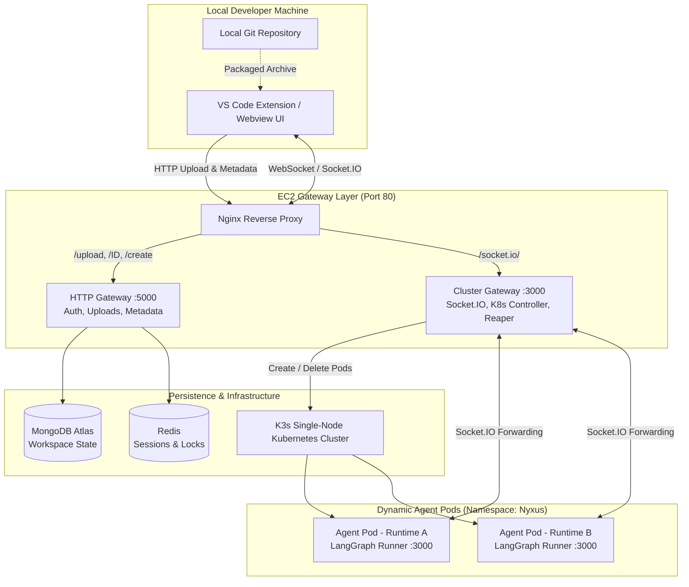
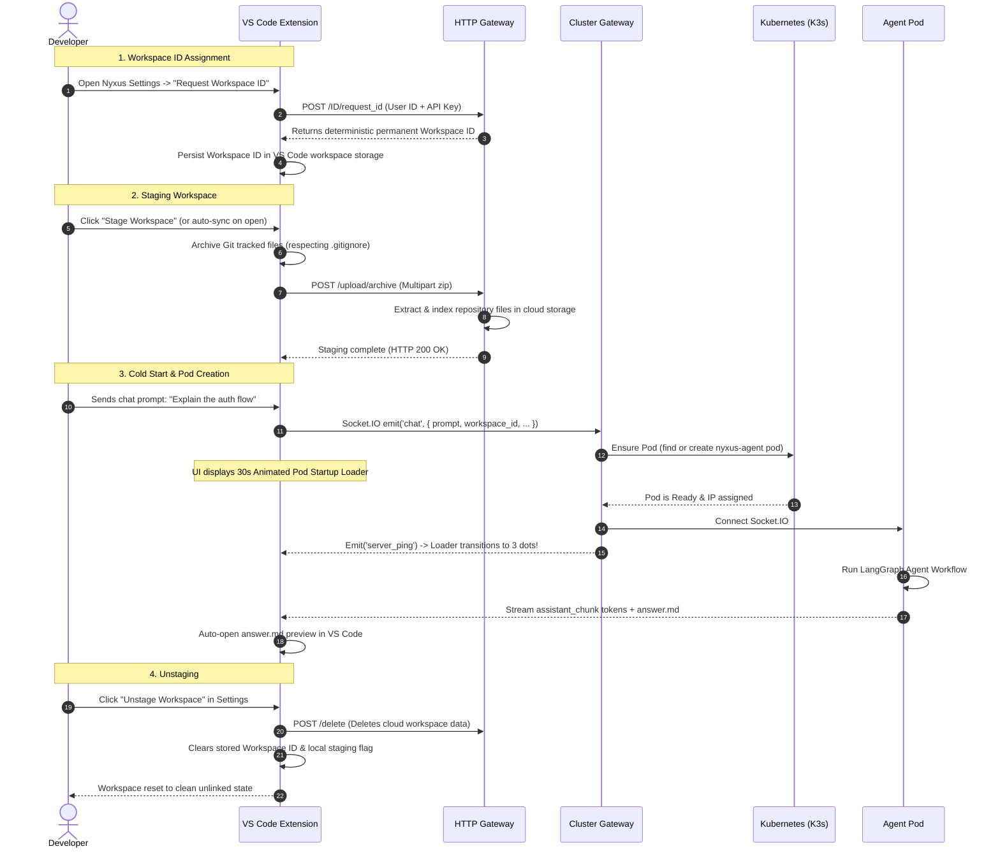
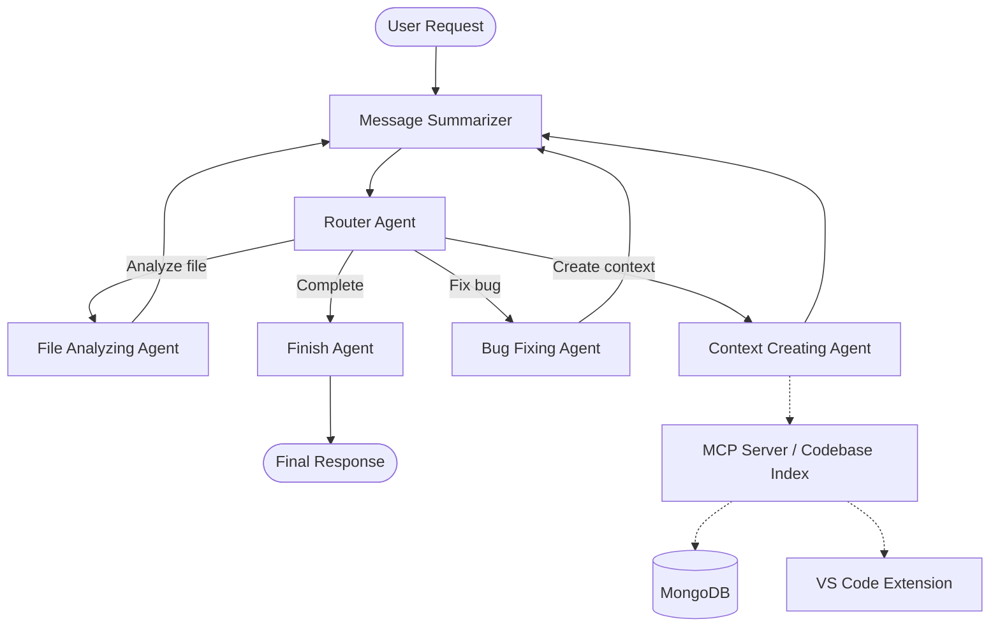

# Nyxus: Autonomous Coding Agent & Cloud-Native Workspace Engine

<p align="center">
  
</p>

<p align="center">
  <strong>An intelligent, cloud-orchestrated pair programmer designed for Visual Studio Code.</strong><br>
  Powered by LangGraph multi-agent reasoning, ephemeral Kubernetes agent runtimes, and deep repository context.
</p>

---

## Table of Contents

- [Overview](#overview)
- [System Architecture](#system-architecture)
- [Why `answer.md` / `README.md` for VS Code?](#why-answermd--readmemd-for-vs-code)
- [Workspace Lifecycle (Staging & Unstaging)](#workspace-lifecycle-staging--unstaging)
  - [1. Workspace ID Assignment](#1-workspace-id-assignment)
  - [2. Staging the Workspace](#2-staging-the-workspace)
  - [3. Unstaging & Remote Deletion](#3-unstaging--remote-deletion)
  - [4. Syncing Incremental Changes](#4-syncing-incremental-changes)
- [Asking Context-Aware Questions](#asking-context-aware-questions)
  - [Cold-Start & Ephemeral Pod Lifecycle](#cold-start--ephemeral-pod-lifecycle)
  - [Query Execution Flow](#query-execution-flow)
- [LangGraph Multi-Agent Architecture](#langgraph-multi-agent-architecture)
- [Project Directory Structure](#project-directory-structure)
- [Configuration & Settings](#configuration--settings)
- [Deployment & Self-Hosting](#deployment--self-hosting)

---

## Overview

**Nyxus** is an end-to-end coding assistant ecosystem that bridges local developer workflows with high-performance, containerized agent runtimes. Instead of executing resource-intensive LLM workflows directly on developer machines or passing raw unvetted file snippets, Nyxus:

1. **Snapshots & stages** local Git project files into an isolated cloud workspace.
2. **Dynamically provisions** a dedicated, sandboxed Kubernetes agent pod on demand.
3. **Orchestrates specialized sub-agents** (file analysis, context creation, bug fixing, summarization) using LangGraph state machines.
4. **Streams rich markdown answers** directly back into VS Code as both an interactive sidebar chat and a full-featured `answer.md` document.

---

## System Architecture

Nyxus is composed of four decoupled subsystems designed for security, scalability, and instant recovery:



### Components

| Component | Technology | Responsibility |
|---|---|---|
| **VS Code Extension** | TypeScript, React, Vite | Sidebar interface, Git archive creation, WebSocket communication, document previewing. |
| **HTTP Gateway** | Node.js, Express, Multer | Authenticates requests, generates Workspace IDs, accepts zip archives, and synchronizes metadata with MongoDB. |
| **Cluster Gateway** | Python, FastAPI, python-socketio, K8s Client | Manages agent pod lifecycles, maps clients to dedicated pods, streams real-time responses, and runs a 20-minute idle pod reaper. |
| **Agent Pods** | Python, LangGraph, Gemini 2.5 Flash | Containerized reasoning units running stateful graph workflows over the staged codebase. |

---

## Why `answer.md` / `README.md` for VS Code?

A central design decision in Nyxus is formatting and saving comprehensive responses into an `answer.md` file in the root of the user's workspace, rather than confining all code and analysis to a cramped chat bubble.

### 1. Solving the "Narrow Sidebar Problem"
Modern coding agent responses often include large code blocks, architecture diagrams, step-by-step diffs, and deep explanations. In a standard 280–350px VS Code sidebar:
- Code blocks require awkward horizontal scrolling.
- Structural hierarchy and multi-file plans become unreadable.
- Users waste time copying snippets out of chat history into temporary files.

### 2. Native Side-by-Side Editor Experience
By saving responses to `answer.md`, Nyxus automatically triggers VS Code's native Markdown Preview (`markdown.showPreviewToSide`):
- **Full Editor Real Estate**: View documentation, math equations (KaTeX), and code side-by-side with your active code files.
- **Interactive Syntax Highlighting**: Native theme colors, line numbering, and bracket pairing.
- **Envelope UI**: In the chat sidebar, Nyxus renders a compact, elegant "Envelope Card" indicating that the response has arrived. Users can open it in the editor with a single click.

### 3. Persistent Documentation & Audit Trail
- Chat webviews in VS Code can be disposed of when the tab closes or the window reloads, losing critical explanations.
- `answer.md` persists directly on disk as a living document of the agent's architectural decisions, debugging steps, and codebase findings.
- Developers can commit `answer.md` to Git or easily incorporate sections into their project's permanent `README.md`.

---

## Workspace Lifecycle (Staging & Unstaging)

Before Nyxus can answer deep contextual questions about your project, the local workspace must be staged.



### 1. Workspace ID Assignment
- When you first open a project with Nyxus, navigate to **Settings** (gear icon in the top right of the sidebar).
- Click **"Request Workspace ID"**.
- Nyxus generates a unique, persistent identifier bound to your workspace folder and user profile. This ID remains tied to this project across reloads.

### 2. Staging the Workspace
- Click **"Stage Workspace"** (or enable auto-sync on sidebar open).
- **What happens under the hood:**
  1. The extension scans your workspace using Git rules.
  2. Large binary assets, `.git` histories, `node_modules`, and anything ignored by `.gitignore` are excluded to keep bundles lightweight.
  3. A tarball/zip archive is streamed over HTTP to the gateway.
  4. The gateway unpacks the files into cloud storage, indexes file paths, and marks the workspace as `staged = true`.

### 3. Unstaging & Remote Deletion
- If you switch projects, want to remove cloud-stored code, or need a clean slate:
  1. Open Nyxus **Settings**.
  2. Click **"Unstage & Delete"**.
  3. The extension notifies the HTTP Gateway to purge all extracted files and metadata from the remote filesystem and database.
  4. Local persistent flags are cleared.

### 4. Syncing Incremental Changes
- After modifying code locally, click **"Sync Workspace"**.
- Only the updated working tree is repacked and sent to update the remote representation, ensuring the agent always reasons over your latest code.

---

## Asking Context-Aware Questions

Once staged, you can ask Nyxus anything about your repository in the sidebar chat.

### Cold-Start & Ephemeral Pod Lifecycle
To optimize cloud infrastructure costs while preventing resource starvation:
- **Idle Pod Reaper**: Any agent pod that has not received chat activity for **20 minutes** is automatically reaped and safely deleted by the cluster gateway.
- **Cold-Start Handling (30s Startup Loader)**:
  - When you send your first message after an idle period, Kubernetes provisions and starts a dedicated agent pod (~15–25 seconds).
  - During this window, the chat UI displays an animated **Pod Startup Loader** with an informative progress indicator:
    ```
    Starting agent pod...
    Provisioning container environment (up to ~30s on cold start)
    [=============================>          ]
    ```
  - As soon as the pod is ready, the gateway emits a `server_ping`. The loader immediately transitions into the familiar **3 typing dots**, and token streaming begins!

### Query Execution Flow
1. **Repository Exploration**: When asked *"Where is authentication handled?"*, the agent inspects the file tree and codebase index.
2. **Dynamic Context Creation**: The agent extracts functions, interfaces, and call graphs relevant to your query.
3. **Synthesis**: The `finish_agent` compiles the answer, code blocks, and diagrams.
4. **Answer Delivery**:
   - The response streams into the sidebar chat.
   - The complete formatted answer is written directly to `answer.md` in your workspace root.
   - VS Code immediately splits your editor to show the rendered Markdown Preview.

---

## LangGraph Multi-Agent Architecture

Nyxus utilizes a multi-agent state graph orchestrated with LangGraph:



### Agent Roles

| Agent | Responsibility |
|---|---|
| `message_summarizer` | Summarizes recent conversation history, user intent, and cumulative agent state to prevent context window overflow. |
| `router_agent` | Acts as the conductor; evaluates current progress and decides which specialist worker should execute next. |
| `file_analyzing_agent` | Evaluates file lists, directory trees, and import hierarchies to pinpoint files containing relevant code. |
| `context_creating_agent` | Gathers exact file contents, method definitions, and semantic relationships for the selected target files. |
| `bug_fixing_agent` | Performs deep debugging, analyzes root causes, and devises targeted patches or refactors. |
| `finish_agent` | Formats final explanations, step-by-step diffs, and Mermaid diagrams into polished Markdown for `answer.md`. |

> [!NOTE]
> A safety limit of **20 router cycles** is enforced per request to guarantee execution bounds and eliminate recursive loops.

---

## Project Directory Structure

```text
project-nyxus/
├── cluster_gateway/              # Cloud Gateway (Port 3000)
│   ├── main.py                   # FastAPI + Socket.IO + K8s Controller + Pod Reaper
│   ├── requirements.txt          # Gateway dependencies
│   └── .env                      # Cluster and database credentials
│
├── nyxusbackend/
│   └── nyxus_gateway/            # HTTP Gateway (Port 5000)
│       ├── server.js             # Express server: /upload, /ID, /create, /delete
│       └── package.json          # Node.js dependencies
│
├── hybridbackend/                # Core Agent Container Image
│   ├── main.py                   # LangGraph runner & Socket.IO client
│   ├── requirements.txt          # LangGraph, LangChain, Google GenAI dependencies
│   └── Dockerfile                # Container spec deployed to Kubernetes
│
├── nyxus_modified/               # VS Code Extension
│   ├── package.json              # Extension manifest (publisher: aryanKaga)
│   ├── extension.js              # Extension entry point & command registration
│   ├── media/                    # Icons and assets
│   ├── webviewprovider/          # Backend providers (SidebarProvider, storage, websockets)
│   └── webview-ui/               # React + Vite sidebar frontend
│       ├── src/components/chat/  # Chat components, MessageList, useNyxusChat hook
│       └── src/components/       # UI styles (NyxusChat.css) and icon definitions
│
├── fox_sniffing_logo.svg         # Official Nyxus theme-adaptive logo
└── README.md                     # Project documentation
```

---

## Configuration & Settings

The extension provides configurable settings under **Settings** $\rightarrow$ **Extensions** $\rightarrow$ **Nyxus**:

| Setting | Default | Description |
|---|---|---|
| `nyxusReplica.url` | `http://54.79.152.236` | Target Nyxus Gateway endpoint (HTTP & Socket.IO). |
| `nyxusReplica.apiKey` | `abc@123` | Authentication key for workspace access and cluster isolation. |
| `nyxusReplica.userId` | `123` | User profile identifier for session persistence. |
| `nyxusReplica.autoReuseWorkspaceId` | `true` | Automatically preserves assigned Workspace ID for the open directory. |
| `nyxusReplica.enableWorkspaceSync` | `true` | Automatically stages and synchronizes code changes. |
| `nyxusReplica.connectionTimeout` | `15000` | Socket connection timeout in milliseconds. |

---

## Deployment & Self-Hosting

### 1. Prerequisites
- Linux host (Ubuntu 22.04+ / 24.04 recommended)
- **K3s** or any standard Kubernetes cluster (`k3s.service`)
- **Redis** (`redis-server` on port 6379)
- **Nginx** reverse proxy
- Python 3.10+ & Node.js 18+

### 2. Running Services

#### Cluster Gateway (Socket.IO & K8s Controller)
```bash
cd cluster_gateway
python3 -m venv .venv
source .venv/bin/activate
pip install -r requirements.txt
uvicorn main:app --host 0.0.0.0 --port 3000 --workers 1
```

#### HTTP Gateway (Uploads & Auth)
```bash
cd nyxusbackend/nyxus_gateway
npm install
node server.js
```

#### Nginx Routing
Configure Nginx to route `/socket.io/` to port `3000` (WebSocket enabled) and all general HTTP traffic (`/`) to port `5000`.

---

## License

Distributed under the Apache 2.0 License. See `LICENSE` for details.