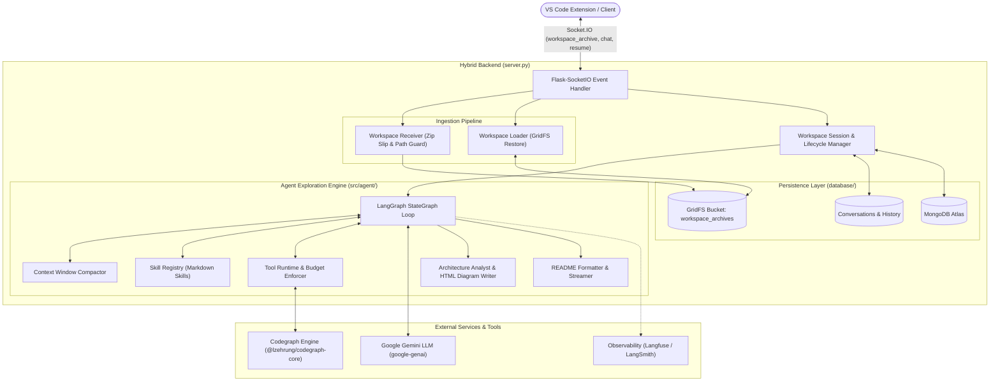

# Nyxus Hybrid Backend

The **Nyxus Hybrid Backend** is a high-performance, real-time agentic backend that powers the Nyxus developer intelligence ecosystem. Built on **Flask-SocketIO**, **LangGraph**, **Google Gemini**, and **`@lzehrung/codegraph`**, it provides codebase exploration, semantic search, dependency tracking, automated architecture diagram generation, and persistent multi-tenant workspace sessions.

---

## Architecture Overview



---

## Key Features

- **Real-Time Bidirectional Communication**: WebSocket-driven streaming via Flask-SocketIO with live token delivery (`assistant_chunk`), heartbeat keep-alives (`assistant_progress`), and flow status hooks (`flow_event`).
- **Graph-Based Codebase Exploration**: Deep structural code navigation using `@lzehrung/codegraph`—including call graphs, reverse dependencies, symbol definitions, packet indexing, and bounded file searching.
- **Agentic Reasoning with LangGraph**: Modular state machine executing multi-turn plans, tool budget caps (max tool calls, read file limits, command timeouts), and proactive rate-limit retry logic.
- **Context Compaction & Token Economy**: Sliding-window context management (`context.py`) keeping tool result stubs, preserving recent verbatim turns, and guarding against token overflow.
- **On-Demand Architecture Diagrams**: Automated two-stage pipeline: an architecture analyst inspects repository subsystems, followed by an HTML diagram writer rendering standalone, sandboxed, responsive pastel block diagrams for VS Code webview previews.
- **Markdown & README Synthesis**: Dedicated post-processing mode (`readme_mode: true`) converting raw exploration traces into polished, publication-ready documentation.
- **Secure Multi-Tenant Workspace Storage**:
  - Safe archive ingestion verifying paths against path traversal (Zip Slip), symlink escapes, and size limits (250MB compressed / 2GB uncompressed).
  - Workspaces stored securely in MongoDB GridFS, scoped to a SHA-256 digest of the user's API key (raw keys are never saved).
  - Automatic local cache eviction: inactive local workspaces are safely cleaned up after 10 minutes of inactivity while remaining restorable from GridFS.
- **Pluggable LLM Provider Architecture**: Default integration with Google Gemini via `google-genai` SDK, with built-in adapters for OpenAI and Anthropic.
- **Enterprise Observability**: Native hooks for Langfuse and LangSmith with optional source code redaction (`hide_inputs_outputs`).

---

## Directory Structure

```
hybridbackend/
├── server.py                     # Main Flask-SocketIO server and session manager
├── package.json                  # Node.js dependencies (@lzehrung/codegraph-core)
├── requirements.txt              # Python runtime dependencies
├── atlas-credentials.env         # MongoDB Atlas connection parameters
├── .env                          # Local environment variables (API keys)
├── database/                     # MongoDB persistence layer
│   ├── mongo_store.py            # MongoDB Atlas & GridFS workspace/chat store
│   ├── storage_session.py        # Storage session abstractions
│   └── test_mongo_store.py       # Persistence unit tests
├── ingestion/                    # Workspace upload and restoration
│   ├── workspace_receiver.py     # Safe ZIP archive unpacking and validation
│   ├── workspace_loader.py       # GridFS workspace retrieval and disk caching
│   ├── test_workspace_receiver.py# Archive security and Zip Slip tests
│   └── test_workspace_loader.py  # Workspace loader tests
├── src/
│   ├── llm_provider/             # LLM client abstractions
│   │   ├── models.py             # Multi-provider adapter (Gemini, OpenAI, Anthropic)
│   │   └── __init__.py
│   └── agent/                    # Core agent loop and codegraph integration
│       ├── agent_loop.py         # LangGraph exploration loop and execution flow
│       ├── architecture.py       # Visual architecture analyzer and HTML generator
│       ├── readme_writer.py      # Polished Markdown answer formatting & streaming
│       ├── context.py            # Context window compaction and token budgeting
│       ├── skills_loader.py      # System prompt composer and skill registry
│       ├── timeouts.py           # Execution deadlines and timeout guards
│       ├── observability.py      # Langfuse, LangSmith, and trace event integration
│       ├── config.yaml           # Agent limits, active tools, skills, and model config
│       ├── cli.py                # Standalone CLI for direct repo exploration
│       ├── check.py              # Configuration and skill integrity validator
│       ├── skills/               # Modular agent skill definitions
│       │   ├── base.md           # Core agent instructions and formatting rules
│       │   ├── ensure-indexed/   # Skill: Index repository with codegraph
│       │   ├── codebase-overview/# Skill: High-level repo structure and entry points
│       │   ├── locate-and-explain/# Skill: Pinpoint symbols and explain logic
│       │   ├── trace-flow/       # Skill: Trace cross-module call/data flows
│       │   └── architecture-diagram/ # Skill: Create visual component diagrams
│       ├── tools/                # Codegraph CLI wrapper and schemas
│       │   ├── codegraph_wrapper.py # Sandboxed CLI tool execution runtime
│       │   └── schemas.json      # Tool allowlist schemas and CLI arguments
│       ├── digestor/             # Summarizer prompt for bulky tool outputs
│       ├── evals/                # Evaluation cases and benchmarking harness
│       └── tests/                # Test suite for agent loop, server, and tools
└── workspaces/                   # Local storage directory for active workspaces
```

---

## Prerequisites

- **Python**: Version 3.11 or newer
- **Node.js**: v18+ and `npm` (required for `@lzehrung/codegraph-core`)
- **MongoDB**: MongoDB Atlas cluster or local MongoDB instance (v6.0+)
- **Google Gemini API Key**: Accessible via `GOOGLE_API_KEY`

---

## Installation & Setup

### 1. Clone the Repository
```bash
git clone <repository-url>
cd project-nyxus/hybridbackend
```

### 2. Install Node Dependencies
Install the codegraph engine:
```bash
npm install
```

### 3. Create and Activate a Python Virtual Environment
```bash
python3.11 -m venv .venv
source .venv/bin/activate
```

### 4. Install Python Dependencies
```bash
python -m pip install --upgrade pip
python -m pip install -r requirements.txt
```

### 5. Configure Environment Variables

Create or update `.env`:
```dotenv
GOOGLE_API_KEY=your_gemini_api_key_here
NYXUS_API_KEY=abc123
NYXUS_HOST=127.0.0.1
NYXUS_PORT=3000
NYXUS_CHAT_TIMEOUT_SECONDS=900
```

Create or update `atlas-credentials.env` (for MongoDB Atlas):
```dotenv
MONGODB_URI=mongodb+srv://<cluster-address>/nyxus?retryWrites=true&w=majority
MONGODB_USERNAME=your_mongodb_user
MONGODB_PASSWORD=your_mongodb_password
MONGODB_DATABASE=nyxus
```

> **Note**: Both `.env` and `atlas-credentials.env` are listed in `.gitignore` to prevent leaking credentials.

---

## Configuration (`src/agent/config.yaml`)

The agent behaviour, tool limits, and model choices are configured in `src/agent/config.yaml`:

| Section | Parameter | Default | Description |
|---|---|---|---|
| `model` | `name` | `gemini-3.5-flash-lite` | Main reasoning model |
| `digest_model` | `name` | `gemini-3.5-flash-lite` | Summarizer model for bulky tool outputs |
| `limits` | `tool_output_tokens` | `1500` | Max character length (~tokens) per tool output |
| `limits` | `max_tool_calls_per_task`| `60` | Hard cap on tool calls per single prompt |
| `limits` | `max_read_file_calls` | `15` | Maximum full file reads per task |
| `limits` | `max_steps` | `192` | LangGraph recursion limit |
| `shell` | `enabled` | `true` | Allows running shell commands inside the workspace |
| `shell` | `timeout_seconds` | `30` | Subprocess timeout for shell execution |
| `context` | `window_tokens` | `128000` | Threshold to trigger context compaction |
| `context` | `compact_fraction` | `0.6` | Fraction of context compacted on overflow |
| `checkpoint` | `backend` | `memory` | State checkpointer (`memory` or `sqlite`) |
| `observability`| `langfuse.enabled` | `false` | Enable Langfuse tracing |
| `observability`| `langsmith.enabled`| `false` | Enable LangSmith tracing |

---

## Running the Application

### Start the Backend Server
Run the Flask-SocketIO server:
```bash
python server.py
```
The server will bind to `http://127.0.0.1:3000` (or `NYXUS_HOST` / `NYXUS_PORT`). It automatically runs an async background task every 30 seconds to clean up idle extracted workspaces.

### Validate Configuration & Skills
Run the sanity checker without making any LLM or codegraph calls:
```bash
python src/agent/check.py
```
You can also run it against a specific repository:
```bash
python src/agent/check.py /path/to/target/repo
```

### Run Standalone CLI Agent
Explore any codebase directly from your terminal:
```bash
# Interactive mode
python src/agent/cli.py --repo /path/to/target/repo

# Single-question mode
python src/agent/cli.py --repo /path/to/target/repo --question "How is authentication handled?"
```

---

## Socket.IO Protocol Reference

The backend communicates with clients (e.g. the Nyxus VS Code extension) over Socket.IO.

### Inbound Events (Client -> Server)

#### 1. `workspace_archive`
Uploads and activates a zipped workspace archive.
- **Payload**:
  ```json
  {
    "apiKey": "abc123",
    "archive": "<binary ZIP buffer>"
  }
  ```
- **Response**:
  ```json
  {
    "ok": true,
    "workspace_id": "97c45540-ade8-453a-9b60-05a1c2c21a5d",
    "file_count": 42
  }
  ```

#### 2. `workspace_resume`
Restores a previously uploaded workspace from MongoDB GridFS and recovers conversation history.
- **Payload**:
  ```json
  {
    "apiKey": "abc123",
    "workspace_id": "97c45540-ade8-453a-9b60-05a1c2c21a5d"
  }
  ```
- **Response**:
  ```json
  {
    "ok": true,
    "workspace_id": "97c45540-ade8-453a-9b60-05a1c2c21a5d",
    "history": [
      {"role": "user", "content": "Where is the router defined?"},
      {"role": "assistant", "content": "The router is located in..."}
    ]
  }
  ```

#### 3. `chat`
Sends a query to the agent for the currently active workspace.
- **Payload**:
  ```json
  {
    "apiKey": "abc123",
    "workspace_id": "97c45540-ade8-453a-9b60-05a1c2c21a5d",
    "prompt": "Explain the data flow from server.py to the agent loop.",
    "readme_mode": false
  }
  ```
- **Response**: `{"ok": true}` (Streaming starts asynchronously).

#### 4. `architecture_diagram_status`
Reports client-side rendering status of a generated HTML diagram.
- **Payload**:
  ```json
  {
    "apiKey": "abc123",
    "workspace_id": "97c45540-ade8-453a-9b60-05a1c2c21a5d",
    "filename": "architecture-diagram-abc123def456.html",
    "status": "rendered"
  }
  ```

---

### Outbound Events (Server -> Client)

| Event | Payload | Description |
|---|---|---|
| `assistant_start` | `{}` | Emitted immediately when agent processing begins. |
| `assistant_progress` | `{"message": "Still working on your request…"}` | Heartbeat emitted every 10 seconds during long tasks. |
| `assistant_chunk` | `{"token": "..."}` | Streamed tokens of the generated response. |
| `flow_event` | `{"event": "agent.call_tool:search"}` | Granular progress events (tool execution, skills). |
| `architecture_diagram` | `{"filename": "...", "title": "...", "html": "..."}` | Generated HTML block diagram ready for webview preview. |
| `readme_answer` | `{"filename": "answer.md", "markdown": "..."}` | Complete polished Markdown answer (when `readme_mode: true`). |
| `agent_trace` | `{"trace": [...]}` | Array of tool executions and observations for debugging. |
| `assistant_end` | `{}` | Signals completion of the chat turn. |
| `assistant_error` | `{"error": "..."}` | Emitted if an unhandled error or deadline timeout occurs. |

---

## Testing

Run all backend test suites using `pytest`:

```bash
# Run all tests across the repository
python -m pytest

# Test the agent loop and server integration
python -m pytest src/agent/tests/

# Test workspace ingestion, extraction, and zip slip protection
python -m pytest ingestion/

# Test MongoDB persistence and multi-tenancy
python -m pytest database/
```

---

## Security & Sandboxing Considerations

- **Path Traversal & Zip Slip Prevention**: Archives uploaded to `workspace_archive` are inspected item by item in `ingestion/workspace_receiver.py`. Null bytes, backslashes, absolute paths, `..` segments, and symlinks pointing outside the workspace sandbox are strictly rejected.
- **API Key Hashing**: All MongoDB workspace records and conversation threads are keyed by `SHA-256(apiKey)`. Raw API keys are never stored in the database.
- **Shell Execution**: The `run_shell` tool operates within the workspace directory using the backend process credentials. Only expose the server to trusted clients and environments, or run the backend inside an isolated container.
- **Diagram Sanitization**: Standalone architecture HTML diagrams generated by `architecture.py` prohibit active content (`<script>`, `<iframe>`, `on*=` event handlers, `javascript:`) so they can be safely rendered in a sandboxed VS Code webview without external network requests.
