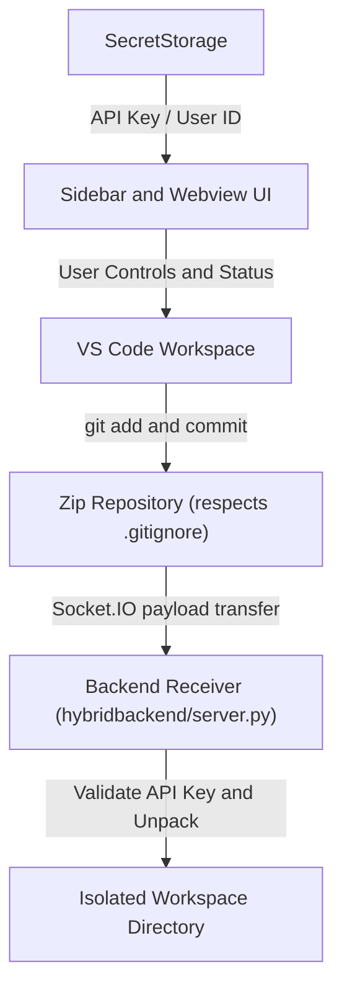

# Nyxus Coding Agent Replica

This repository contains the **Nyxus Coding Agent Replica**, a Visual Studio Code extension paired with a companion backend receiver designed to capture and transmit Git repository snapshots to a local workspace receiver [nyxus_modified/README.md:1-15].

## Core Architecture & Modules

The repository is organized into extension-side components for user interaction and workspace management, alongside a backend server for handling incoming repository payloads:

| Module / Component | Path | Description |
| :--- | :--- | :--- |
| **VS Code Extension** | `nyxus_modified/extension.js` | Entry point for the extension that registers commands, activates the sidebar provider, and manages extension lifecycle events. |
| **Sidebar & Webview UI** | `nyxus_modified/webviewprovider/SidebarProvider.js` `nyxus_modified/webview-ui/` | A React-based webview interface in the sidebar providing user controls, chat/markdown rendering, and status feedback. |
| **Git Staging & Transfer** | *Core Workflow* | Automatically stages workspace changes (`git add --all`), creates a local commit, zips the repository while respecting `.gitignore`, and transmits the compressed payload via Socket.IO to a workspace receiver [nyxus_modified/README.md:3-14]. |
| **Storage & Configuration** | `nyxus_modified/webviewprovider/api_key_storage.js` `user_id_storage.js` | Securely stores API keys using VS Code's `SecretStorage` and tracks user identification [nyxus_modified/README.md:27-29]. |
| **Backend Receiver** | `hybridbackend/` | A companion Python server (`server.py`) that listens on `127.0.0.1:3000`, validates API keys, and securely unpacks archives into isolated workspace directories [nyxus_modified/README.md:21-27]. |

## Workflow Overview

