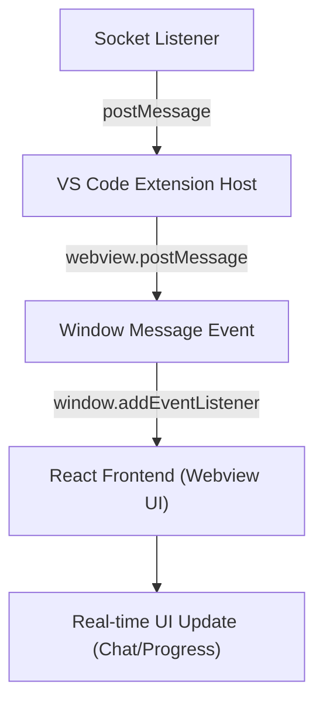

# Data Forwarding & Destination

The data captured by the socket listener is forwarded directly to the **VS Code Sidebar Webview UI (React frontend)** running inside the VS Code editor panel.

## Forwarding Pathway



### 1. Extension Host (`create_websocket.js`)
The `postMessage` helper packages the server response into a message object and calls the VS Code webview API:

```javascript
webview.postMessage({ type: 'assistant_chunk', text: data.token });
```

### 2. Webview UI Frontend (`nyxus_modified/webview-ui/src/components/chat/useNyxusChat.js` / `App.jsx`)
The React application inside the sidebar listens for messages sent from the extension host using standard browser events:

```javascript
window.addEventListener("message", handleMessage);
```

When `assistant_chunk` or other responses arrive, the React components catch them and update the UI state in real time (e.g., rendering chat text streams or progress notifications to the user).