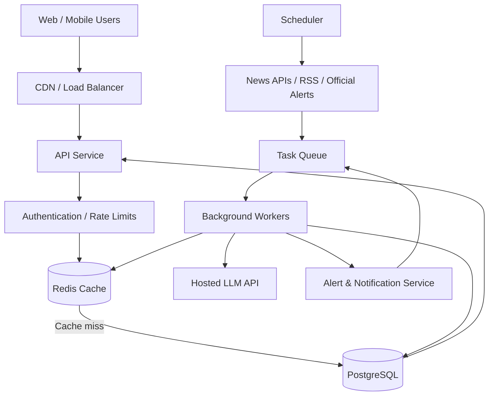
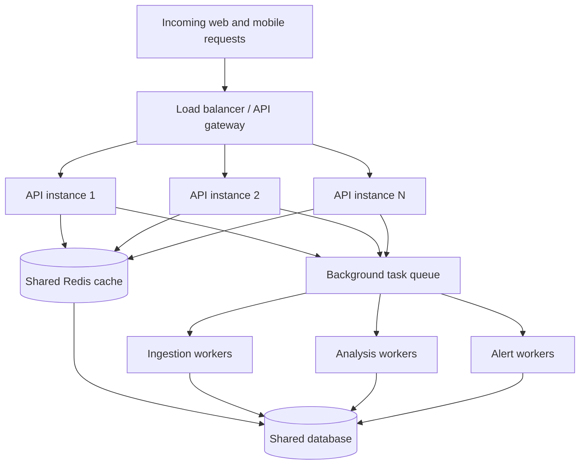

# System Design for a Personalized, Location-Aware AI News Platform

> **Purpose:** Design an end-to-end news system that serves personalized global and local news, collects and analyzes articles in the background, caches shared results, and sends carefully validated alerts about events that may affect users or people they care about.
>
> **Architecture recommendation:** Begin with a modular backend and separate background workers. Add more microservices only when measured traffic, reliability, or deployment requirements justify them.

---

## 1. Core design decisions

The proposed architecture is heading in the right direction. The key ideas are precomputing popular news, refreshing data according to source freshness, and using background workers so user requests do not have to perform every operation sequentially.

Make four important design choices:

1. **Use a hybrid architecture rather than starting with many microservices.** Keep the code modular, but initially deploy only a few independently running components.
2. **Separate news collection from user requests.** Collect and analyze shared news in the background. User requests should primarily read prepared data from the database and cache.
3. **Use asynchronous I/O, worker processes, and horizontal scaling for different kinds of concurrency.** You do not need a GPU or a separate AI agent for every user.
4. **Use caching at multiple levels.** Cache shared news feeds, search results, and generated summaries, but keep personal relevance decisions tied to each user's profile.

The system has two main paths:

- **Background path:** Fetch → normalize → deduplicate → analyze → store → update caches → evaluate alerts.
- **User-request path:** Authenticate → identify interests and locations → retrieve cached/stored articles → personalize/rank → return results.

This separation is central to supporting many simultaneous users without repeatedly calling every external news API for each request.

---

## 2. High-level architecture



This is a **logical diagram**, not a requirement to deploy every box as a separate service. Initially, several components can be modules inside one codebase or a small number of processes.

### Responsibilities

| Component | Responsibility | Execution style |
|---|---|---|
| API service | Login, search, personalized feeds, profile management | Request-driven |
| Scheduler | Decide which source is due for fetching | Periodic/background |
| Ingestion workers | Fetch RSS/API results and normalize articles | Concurrent I/O |
| Analysis workers | Deduplicate, extract locations, classify and rank articles | Async jobs; CPU processes only if needed |
| Database | Store articles, profiles, locations, and event records | Durable storage |
| Redis cache | Store popular feeds, search results, and short-lived data | Fast shared reads |
| Task queue | Distribute background work and absorb traffic spikes | Asynchronous |
| Alert service | Evaluate official warnings and send user-configured alerts | Event-driven/high priority |
| Hosted AI provider | Summarize, classify, and interpret articles | Network API calls |

The load balancer distributes incoming HTTP requests across API instances. A task queue distributes background jobs across workers. These are two distinct forms of load distribution.

---

## 3. How traffic should flow

### A. Common news: collect once, serve to many users

Suppose 10,000 users are interested in technology news. Do not make 10,000 external news API requests to produce essentially the same feed.

Instead:

1. A background worker retrieves technology news.
2. Articles are normalized, deduplicated, and stored.
3. An analysis worker classifies their topics, locations, and other relevant attributes.
4. The system prepares and caches a shared technology feed.
5. Interested users retrieve that shared feed, with their preferences used to rank or filter it.

This is shared precomputation. In feed architecture terminology, it resembles **fan-out-on-write** for shared data.

It reduces duplicate requests, repeated AI processing, and external API costs.

### B. User-specific news: retrieve on demand

Suppose a user searches for:

> New gaming studios opening in Pune that could affect local employment.

The system can:

1. Search the internal article database and cached results.
2. Check relevant sources for recent matching stories.
3. Run relevant external searches concurrently, within request and provider limits.
4. Analyze only new or unprocessed results.
5. Store the resulting records so later users or queries can reuse them.

This resembles **fan-out-on-read** for user-specific retrieval. The application combines the existing news corpus with targeted searches when needed.

The best approach is hybrid:

- Shared feeds are precomputed.
- Personalized views are assembled from shared records.
- Genuinely new or unusual queries trigger targeted retrieval.

For an interactive request, do not wait indefinitely for every external source. Return available results promptly and refresh in the background when appropriate.

---

## 4. Polling intervals, cache TTL, and urgency are different

The idea of refreshing news throughout the day is correct, but the system should distinguish three things:

- **Polling interval:** How often a source is checked for updates.
- **Cache time-to-live (TTL):** How long cached data can be considered fresh before it should be refreshed.
- **Importance or urgency:** How quickly a new event should be processed and possibly delivered.

These should not share one timer.

For example, GDELT has documented a 15-minute update interval for its GEO 2.0 API, but this should not be assumed to describe every GDELT endpoint. See the GDELT documentation: https://blog.gdeltproject.org/gdelt-geo-2-0-api-debuts/

### Illustrative initial polling policy

These are starting configuration values for your system, not promises from providers.

| Source category | Initial polling target | Processing priority |
|---|---:|---|
| Official emergency feeds | 1–5 minutes, only if permitted and useful | Critical |
| High-interest breaking news | 5 minutes | High |
| Global and national news | 5–15 minutes | Normal/high |
| Major city news | 10–15 minutes | Normal |
| Low-activity locality feeds | 15–60 minutes | Normal/low |
| Historical backfills | Scheduled batches | Low |

Configure each source with its own minimum interval, provider limits, and failure policy. Respect any source-defined update cadence and request limits.

### Source registry

Keep source configuration in the database rather than hard-coding the schedule into every worker.

```json
{
  "source_id": "global_technology",
  "type": "rss",
  "url": "https://example.com/feed.xml",
  "poll_interval_seconds": 300,
  "priority": "normal",
  "last_checked_at": null,
  "next_fetch_at": null,
  "last_success_at": null,
  "error_count": 0,
  "enabled": true
}
```

The URL is illustrative.

The scheduler should select sources whose `next_fetch_at` is due, create fetch jobs, and move on. Do not create an independent timer for every user or every feed page.

Where supported, use conditional HTTP requests such as `ETag` or `Last-Modified`, follow publisher caching instructions, and avoid reprocessing unchanged feed entries.

---

## 5. Cache design

Use Redis as a shared cache if it fits your deployment. The database remains the source of truth; Redis is an optimization.

Redis's cache-aside pattern reduces repeated database reads by storing cached results with a bounded TTL. Cache stampedes occur when many concurrent requests try to refill the same expired key. See: https://redis.io/learn/howtos/solutions/microservices/caching

### Three cache tiers

#### Tier 1 — Popular shared feeds

Examples:
- Global headlines
- India news
- Technology
- Gaming
- Mumbai city news

Refresh shared data according to source cadence. Users should not trigger fresh external API calls for every visit.

#### Tier 2 — Personalized feeds

Retrieve shared articles based on a user's interests and followed locations.

Cache the personalized result briefly, keyed by the user and profile version. Refresh it when relevant articles or preferences change.

#### Tier 3 — On-demand searches

Cache repeated searches using a normalized query, language, region, and relevant filters. Expire them according to expected freshness and how quickly new results are likely to appear.

### Example cache keys

```text
feed:global:en:headlines
feed:topic:technology:en
feed:city:mumbai:news
feed:city:pune:news
feed:user:123:profile-v4
search:pune-flood:en-IN
```

These key names are illustrative.

### Example TTL policy

| Data | Starting TTL | Additional rule |
|---|---:|---|
| Breaking-news feed | 1–3 minutes | Refresh when new articles arrive |
| Popular topics | 3–5 minutes | Background refresh |
| City news | 5–15 minutes | Respect source freshness |
| Low-activity locality search | 15–30 minutes | Revalidate sooner when useful |
| User-specific feed | 1–5 minutes | Invalidate when profile or underlying news changes |
| Official alert | Very short cache or event-driven update | Respect issue time, validity, and update/withdrawal messages |

These are examples, not fixed recommendations for every source. A five-minute cache cannot make a source that refreshes every 15 minutes deliver five-minute-fresh data.

For urgent alerts, use the alert's validity and update semantics rather than relying only on an ordinary news-feed TTL.

### Avoid cache stampedes

If 5,000 users request a feed when its cache expires, do not let all 5,000 rebuild it.

Use a single-flight refresh or distributed lock per cache key. One worker refreshes the data while other requests temporarily use a still-valid or explicitly permitted stale result.

---

## 6. Python, the GIL, and parallelism

**Python is a good choice for this backend. The GIL is not a reason to avoid it.**

The important thing is to match the concurrency method to the workload.

| Workload | Example | Recommended approach |
|---|---|---|
| I/O-bound | Fetch RSS feeds, call news APIs, wait for LLM responses | `asyncio` / `async`-`await` |
| CPU-bound | Heavy text processing, Python-only analysis, expensive transformations | Process pool or separate worker processes |
| Multiple HTTP requests | Many users loading feeds simultaneously | Async API server, multiple instances, load balancer |
| Background jobs | Fetching, enrichment, summary generation | Queue-backed workers |
| AI inference | Calling an external language model | Async HTTP requests with concurrency limits |

Python's documentation explains that the GIL restricts simultaneous execution of Python bytecode in traditional CPython builds, but threads remain useful for I/O-bound tasks. Multiprocessing can supply parallelism for CPU-heavy workloads.

References:
- Python threading: https://docs.python.org/3/library/threading.html
- Python multiprocessing: https://docs.python.org/3/library/multiprocessing.html
- FastAPI async guidance: https://fastapi.tiangolo.com/async/

### Why asynchronous I/O fits this system

Suppose the backend needs to check five news sources. With sequential requests, it waits for each network call to finish before starting the next one.

With asynchronous I/O, it starts several requests, lets them wait concurrently, and processes results as they arrive. Use timeouts and concurrency limits; asynchronous I/O does not mean unlimited requests.

### Basic concurrent RSS/API fetch example

Install the HTTP library:

```bash
pip install httpx
```

Example:

```python
import asyncio
import httpx

URLS = [
    "https://example.com/feed1",
    "https://example.com/feed2",
    "https://example.com/feed3",
]

async def fetch(client: httpx.AsyncClient, url: str) -> str:
    response = await client.get(url, timeout=10)
    response.raise_for_status()
    return response.text

async def main() -> None:
    limits = httpx.Limits(
        max_connections=20,
        max_keepalive_connections=10,
    )

    async with httpx.AsyncClient(limits=limits) as client:
        results = await asyncio.gather(
            *(fetch(client, url) for url in URLS),
            return_exceptions=True,
        )

    for url, result in zip(URLS, results):
        if isinstance(result, Exception):
            print("Failed:", url, result)
        else:
            print("Fetched:", url, len(result), "characters")

if __name__ == "__main__":
    asyncio.run(main())
```

This is a basic example. A production collector also needs per-provider limits, retry policies, response-size limits, and suitable XML/feed parsing.

It demonstrates **concurrent network I/O**, not CPU parallelism.

### Do you need PyTorch or a GPU?

No—not for the initial version.

Your backend can send article titles and descriptions to a hosted LLM API for classification, location extraction, and summarization. The provider runs model inference on its own infrastructure, subject to pricing and usage limits. Your application mainly manages network requests and structured results.

Consider local CPU/GPU inference later if you have a measured reason, such as predictable high-volume inference costs, strict data-locality requirements, or a custom-model requirement. Heavy local inference can be deployed as a separate service.

---

## 7. Load balancing, API instances, and worker pools

Do not think of this as “one agent per user.” Separate the capacity for serving requests from the capacity for background processing.



### How to scale

Scale API instances based on:
- Request rate
- Response latency, especially p95
- CPU and memory
- Connection capacity

Scale background workers based on:
- Queue depth
- Age of the oldest pending job
- Processing time
- Provider limits

Keep database connection pools bounded. If each API instance opens too many database connections, adding more replicas can overwhelm the database rather than improve performance.

Use backpressure: if analysis workers are overloaded, delay low-priority summarization jobs rather than building an unbounded queue backlog.

---

## 8. Pub/Sub and multi-agent orchestration

A task queue or message broker decouples the component that produces work from the component that performs it. Producers publish jobs; workers process them independently.

### Example processing flow

```text
article.discovered
       ↓
article.normalization
       ↓
article.normalized
       ↓
article.analysis
       ↓
article.analyzed
       ↓
article.location_matched
       ↓
feed.cache_update
       ↓
alert.evaluate
```

Not every article needs every step. An official emergency alert may go directly to geographic matching and alert evaluation. An ordinary article may continue through topic extraction, ranking, and summarization.

### Queue and broker options

| Stage | Option | When it fits |
|---|---|---|
| Prototype | Redis-backed task queue or database-backed jobs | Small workload and quick development |
| Moderate workload | Celery with Redis or RabbitMQ | Dedicated background workers and retries |
| Managed cloud workload | Google Cloud Pub/Sub | Managed messaging and scalable consumers |
| Very high-volume event streaming | Kafka or another streaming platform | When throughput, replay, and retention needs justify it |

References:
- Celery: https://docs.celeryq.dev/
- Redis Streams: https://redis.io/docs/latest/develop/data-types/streams/
- Google Cloud Pub/Sub: https://cloud.google.com/pubsub/docs
- Kafka: https://kafka.apache.org/documentation/

**Important:** Redis Pub/Sub itself is not a durable job queue. Redis Streams provides persisted entries, consumer groups, acknowledgements, and pending-message tracking.

### Avoid too many AI agents

Start with a deterministic workflow that calls normal functions or narrowly scoped AI tasks:

- Collector retrieves data.
- Analyzer extracts structured information.
- Ranker determines relevance.
- Alert evaluator applies stricter safety rules.
- Notification worker delivers alerts.

This already provides a useful multi-stage AI system. Use an autonomous agent framework only if it demonstrates value beyond a regular workflow.

Make background work **idempotent**. If a job executes twice after a timeout or retry, it should not create duplicate articles or send duplicate alerts.

---

## 9. Deployment architecture

For an initial deployment, keep the system small.

### Frontend — Next.js on Vercel

Use it for the web application, login pages, user profile management, and news-feed UI. This fits request-driven frontend hosting.

### Backend — FastAPI in a container

Run API routes and, initially, separate worker processes from the same codebase. Choose a deployment platform that supports the runtime model and background execution you need.

### Database — PostgreSQL, with optional Redis

PostgreSQL stores articles, profiles, locations, and alerts. Add Redis for high-volume cache reads and queue processing when needed.

### Scheduler and background worker

Use a reliable scheduler or continuously running worker to check source schedules, process due jobs, and retry failures. Do not rely on a web request happening to trigger collection.

### Hosted AI API

Use hosted LLM inference for analysis and summaries at first. Add local inference only when economics or requirements justify it.

### Vercel limitation

Vercel can work well for the frontend and suitable request-driven functions, but do not assume the free plan can run your 15-minute background scheduler. Vercel's published January 2026 documentation described Hobby cron jobs as limited to once per day, with invocation timing allowed to vary within the hour.

Check the current documentation before deployment:
- Vercel Cron Jobs: https://vercel.com/docs/cron-jobs
- Vercel Functions: https://vercel.com/docs/functions

A collection cycle intended to run every 15 minutes should use a separate scheduler/worker environment rather than depending on Vercel Hobby cron.

A service such as Google Cloud Run Jobs supports configurable task parallelism for batch collection and historical processing. Hosting costs and configuration need to be assessed rather than assuming it is free:
- https://cloud.google.com/run/docs/create-jobs

**Deployment recommendation:** Use Vercel for the frontend if it suits your needs, but deploy Python backend and background execution in an environment that supports your workload. Start with a few components and measure usage before adding more infrastructure.

---

## 10. Operational controls

Even a small deployment needs production safeguards.

- **Provider rate limits:** Configure per-provider limits, timeouts, and retry policies.
- **Retries:** Use exponential backoff with jitter for transient errors; do not retry permanent errors indefinitely.
- **Circuit breakers:** Temporarily stop calling a failing provider so it does not exhaust resources.
- **Queue prioritization:** Safety alerts must not be blocked behind bulk article summarization.
- **Deduplication:** Use canonical URLs, source identifiers, and content hashes where appropriate.
- **Idempotent notifications:** Prevent duplicate delivery after worker retries.
- **Rate limits:** Protect search endpoints from abuse and expensive query loops.
- **Database limits:** Use connection pooling and pagination.
- **Fallback behavior:** When an external API is unavailable, return saved news and clearly indicate freshness when needed.
- **Cost controls:** Limit LLM tokens, cache reusable analyses, and track cost per processed article.

### Metrics to monitor

| Metric | Why it matters |
|---|---|
| API request rate and p95 latency | User experience under traffic |
| Cache hit ratio | Whether caching reduces database/API load |
| Source fetch success and freshness | Whether news remains up to date |
| Queue depth and oldest job age | Whether workers are falling behind |
| AI processing time and cost | Whether analysis is affordable |
| Database connection saturation | Whether the database can handle concurrent requests |
| Alert delivery latency and duplicate rate | Whether safety notifications work reliably |
| Relevance feedback | Whether the system is useful to users |

---

## 11. Implementation roadmap

### Phase 1 — Functional baseline

- Build a modular backend, one database, and a collection worker.
- Fetch global, technology, gaming, Mumbai, and Pune news.
- Store structured articles and make the feed work end to end.
- A shared in-process cache is acceptable for local development.

**Deliverable:** A working prototype that collects and displays current stories.

### Phase 2 — Concurrent collection and caching

- Add asynchronous HTTP requests.
- Set controlled concurrency and per-source schedules.
- Add shared caching and deduplication.
- Measure latency and provider usage.

**Deliverable:** Collection that is efficient and does not repeat unnecessary requests.

### Phase 3 — Background AI processing

- Add worker jobs for topic extraction, location resolution, classification, and summarization.
- Process each article once where possible and reuse analysis across users.

**Deliverable:** Structured article records that can be filtered and ranked.

### Phase 4 — Alerts and reliability

- Integrate official disaster/weather feeds.
- Add alert validity checks, notification deduplication, and privacy controls.
- Test failures and false positives before enabling real notifications.

**Deliverable:** A safer alert workflow.

### Phase 5 — Scale based on evidence

- Introduce a durable message broker.
- Independently scale ingestion and AI workers.
- Add multiple API replicas.
- Split out separate services only when metrics identify a bottleneck.
- Add richer search or embeddings only if basic indexing is insufficient.

**Deliverable:** A system that can scale based on demonstrated needs.

---

## 12. Final recommendation

Your instinct about concurrent fetching, scheduled precomputation, caching, a load balancer, and Pub/Sub is sound. The main change is to avoid implementing a large microservice-based, multi-agent system immediately.

Start with a **modular monolith plus separate background workers**:

- FastAPI with asynchronous I/O
- PostgreSQL as the source of truth
- Shared caching when useful
- A simple task queue when background work needs independent execution
- Per-source schedules
- Precomputed popular feeds
- Hosted LLM APIs for article analysis
- Separate, high-priority handling for official emergency alerts

When traffic grows, scale API instances and workers independently. Split into separately deployed services only when metrics, reliability, or deployment needs justify the extra complexity.

This approach gives you an end-to-end architecture without making the first deployment unnecessarily expensive or hard to debug.