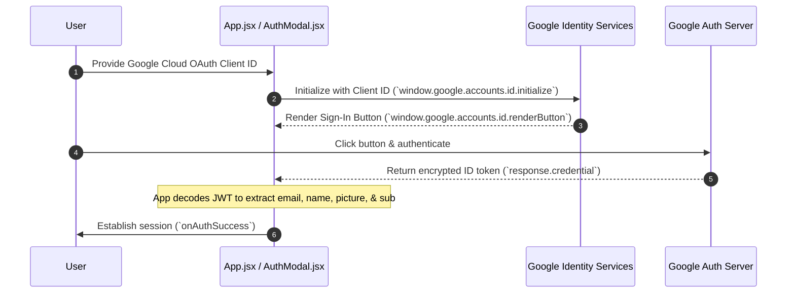

# Google Authentication: Location & Workflow

This document explains where Google Authentication is implemented in the repository and outlines the step-by-step workflow of how it operates.

---

## Where is it located?

Google Auth is implemented entirely on the client-side within the React frontend components. 

| Component / File | Path | Role |
| :--- | :--- | :--- |
| **HTML Loader** | `website/index.html` | Loads the Google Identity Services (GIS) script (`https://accounts.google.com/gsi/client`) [website/index.html:12]. |
| **Auth Modal Component** | `website/src/components/AuthModal.jsx` | Handles Google Client ID verification, GIS initialization, Google Sign-In button rendering, and credential response handling [website/src/components/AuthModal.jsx:20-66]. |
| **Client ID State Management** | `website/src/App.jsx` | Manages the storage and persistence of the Google OAuth Client ID (`nyxus_google_client_id` in `localStorage` or `VITE_GOOGLE_CLIENT_ID`) [website/src/App.jsx:22-26]. |

---

## How does it work?

The authentication process flows through five main steps:

### 1. Prerequisite (Client ID Configuration)
The user provides a valid Google Cloud OAuth Client ID ending in `.apps.googleusercontent.com` (configured via the app UI or environment variable) [website/src/components/AuthModal.jsx:13-18].

### 2. Initialization (`window.google.accounts.id.initialize`)
When the authentication modal opens (`AuthModal.jsx`), if a valid Client ID is present, Google Identity Services initializes with a callback function [website/src/components/AuthModal.jsx:25-29].

### 3. Button Rendering (`window.google.accounts.id.renderButton`)
Google's official sign-in button is rendered inside a React ref (`googleBtnRef`) [website/src/components/AuthModal.jsx:51-60].

### 4. Credential Exchange & JWT Decoding
When the user clicks the Google button and authenticates with Google, Google returns an encrypted ID token (`response.credential`). The app decodes this JSON Web Token (JWT) using `jwt-decode` to extract the user's `email`, `name`, `picture`, and `sub` (Google subject ID) [website/src/components/AuthModal.jsx:31-39].

### 5. Session Success
The extracted profile is passed up via `onAuthSuccess`, establishing the user session and assigning their Google email as their User ID (used for the VS Code extension) [website/src/components/AuthModal.jsx:38-40, 118].